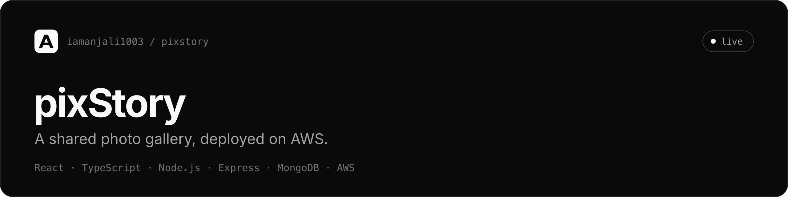

A shared photo gallery for trips, workshops and the everyday moments worth remembering.

[Live](http://Pixstory-env-1.eba-55bqi3ks.ap-south-1.elasticbeanstalk.com) · [Architecture](ARCHITECTURE.md) · [Setup guide](SETUP.md)

## Overview

People sign up, upload photos with a caption, location and activity tag, and
browse a public feed of everyone's memories. The React frontend and the Express
API are served together from one server on AWS Elastic Beanstalk. Images are
stored in Amazon S3 and delivered through CloudFront; accounts and memories live
in MongoDB Atlas.

## Features

- Email and password accounts, with bcrypt-hashed passwords and JWT sessions
- Uploads go straight from the browser to S3 through a presigned URL, so image bytes never pass through the server
- Images are served by CloudFront from a private bucket that only CloudFront can read
- A public feed, newest first, with likes and comments
- Full-text search across caption, location and activity
- One deployment: the website and the API share an address, so there is no CORS to configure

## Tech stack

| Area | Choice |
| --- | --- |
| Frontend | React 19, Vite 6, TypeScript, TailwindCSS v4 |
| UI components | shadcn/ui (Button, Input, Label, Card, Badge, Textarea) |
| Icons | lucide-react |
| Routing / data | React Router v7, TanStack Query v5 |
| Backend | Node.js, Express 5, TypeScript |
| Database | MongoDB Atlas (Mongoose 8) — users + memories |
| Auth | JWT (email + password) with bcrypt |
| Image storage | Amazon S3 (private bucket, presigned uploads) |
| Image delivery | Amazon CloudFront |
| Hosting | AWS Elastic Beanstalk — one server runs the API and serves the React build |

The colour palette is strict grayscale; all design tokens live as CSS variables in `client/src/index.css`.

## How it works

```
              Browser
                 |  http (one address)
                 v
   AWS Elastic Beanstalk  (one EC2 server, Express)
     • serves the React website   (/)
     • answers the API            (/api/...)
                 |                         |
   presigned upload                 Mongoose
                 v                         v
          Amazon S3 (private)       MongoDB Atlas
                 |
       read via Origin Access Control
                 v
          Amazon CloudFront  ->  browser loads images from the CDN
```

The Express server serves the compiled React app for any non-API route and
handles `/api/...` itself. Full detail is in [ARCHITECTURE.md](ARCHITECTURE.md).

## Getting started

You need **Node.js 22+**, a **MongoDB Atlas** connection string, and (for image upload to work) an **AWS S3 bucket + CloudFront + IAM keys**. The full walkthrough is in [SETUP.md](./SETUP.md); the short version:

### 1. Backend

```bash
cd server
npm install
cp .env.example .env        # fill in the values (see below)
npm run dev                 # http://localhost:4000
```

### 2. Frontend (second terminal)

```bash
cd client
npm install
cp .env.example .env.local  # VITE_API_URL=http://localhost:4000
npm run dev                 # http://localhost:5173
```

Open http://localhost:5173.

### Environment variables

#### `server/.env`

| Key | Purpose |
| --- | --- |
| `PORT` | Port Express listens on (`4000` for dev). On Elastic Beanstalk this is set automatically. |
| `MONGODB_URI` | MongoDB Atlas connection string. |
| `JWT_SECRET` | Long random string. Generate with `openssl rand -hex 32`. |
| `JWT_EXPIRES_IN` | Token lifetime, e.g. `7d`. |
| `AWS_REGION` | Region of the S3 bucket, e.g. `ap-south-1`. |
| `AWS_ACCESS_KEY_ID` / `AWS_SECRET_ACCESS_KEY` | Keys for an IAM user with S3 access. |
| `S3_BUCKET` | Bucket that stores uploaded images. |
| `CLOUDFRONT_DOMAIN` | CloudFront domain that serves images, e.g. `d111abc.cloudfront.net`. |
| `CORS_ORIGINS` | Allowed origins for local dev, e.g. `http://localhost:5173`. |

#### `client/.env.local`

| Key | Purpose |
| --- | --- |
| `VITE_API_URL` | Backend base URL. `http://localhost:4000` for local dev. Left **empty** in the production build so the app calls the API on the same address it is served from. |

> `.env` files are gitignored. Secrets are never committed; in production they are set in the Elastic Beanstalk console.

## Deployment

The frontend is built and bundled into the backend, and the whole thing is deployed to Elastic Beanstalk as one app. Step-by-step (Atlas, S3, CloudFront, IAM, Elastic Beanstalk) is in [SETUP.md](./SETUP.md). In short:

1. Build the client with `VITE_API_URL` empty so it calls the same-origin API.
2. Copy the build into `server/public`.
3. Zip `server/` and upload it in the Elastic Beanstalk console.
4. Set the environment variables (above) in the Elastic Beanstalk console.

Elastic Beanstalk installs dependencies, compiles the TypeScript, and starts the server, which serves both the website and the API.

## API reference

All endpoints return JSON. Authenticated endpoints expect `Authorization: Bearer <token>`.

| Method | Path | Auth | Description |
| --- | --- | --- | --- |
| `POST` | `/api/auth/signup` | – | Create an account. Body: `{ email, password, name }`. Returns `{ token, user }`. |
| `POST` | `/api/auth/login` | – | Returns `{ token, user }`. |
| `GET` | `/api/memories?q=<text>` | optional | Newest first, up to 100. `q` runs a text search across caption / location / activity. |
| `POST` | `/api/memories/upload-url` | required | Body: `{ contentType, fileExtension }`. Returns `{ uploadUrl, s3Key }`. |
| `POST` | `/api/memories` | required | Body: `{ s3Key, caption, location, activity }`. Returns `{ memory }`. |
| `POST` | `/api/memories/:id/like` | required | Toggles a like. Returns `{ memory }`. |
| `POST` | `/api/memories/:id/comments` | required | Body: `{ text }`. Returns `{ memory }`. |

`GET /health` is a liveness probe used by Elastic Beanstalk.

## Scripts

### `server/`

| Script | What it does |
| --- | --- |
| `npm run dev` | Start the API with auto-reload. |
| `npm run build` | Compile TypeScript to `dist/`. |
| `npm start` | Run the compiled server (used by Elastic Beanstalk). |
| `npm run typecheck` | Type-check only. |

### `client/`

| Script | What it does |
| --- | --- |
| `npm run dev` | Vite dev server on http://localhost:5173. |
| `npm run build` | Type-check and build the production bundle into `dist/`. |
| `npm run preview` | Serve the production build locally. |
| `npm run typecheck` | Type-check only. |

## Project structure

```
pixstory/
├── client/            # React app (Vite)
│   └── src/
│       ├── pages/         # Gallery, Upload, Login, Signup
│       ├── components/    # Navbar, MemoryCard, ProtectedRoute, ui/ (shadcn)
│       └── lib/           # api client, auth store, site.config, helpers
├── server/            # Express API + serves the built React app
│   └── src/
│       ├── routes/        # auth, memories
│       ├── models/        # User, Memory (Mongoose)
│       ├── middleware/    # auth, error handling
│       ├── lib/           # env, db, s3, jwt helpers
│       └── index.ts       # bootstrap: static site + API + DB
├── README.md
├── ARCHITECTURE.md    # architecture & AWS services
└── SETUP.md           # step-by-step setup guide
```

Every source file starts with a short header comment explaining what it does.

## Configuration

Everything brand-related (name, tagline, logo icon, social preview) lives in one
file, `client/src/lib/site.config.ts`. The colour palette lives in
`client/src/index.css`. See [SETUP.md](SETUP.md) for the full table.

## License

[MIT](LICENSE) © 2026 [Anjali](https://iamanjali1003.github.io)
